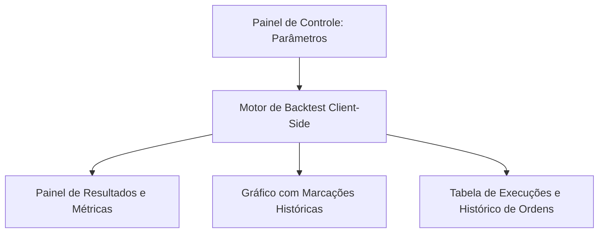

# Planejamento: Simulador de Estratégias (Backtester Client-Side)
**Data de Criação**: 18 de Julho de 2026  
**Status**: Fase de Planejamento Técnico e Arquitetura  
**Escopo**: Execução 100% Client-Side (Navegador do Usuário)

---

## 1. Visão Geral e Conceito
O objetivo deste simulador é permitir que os usuários do **VortexWeb** avaliem o desempenho histórico de suas estratégias customizadas (Cenário A) antes de ativá-las em conta real ou modo de alerta ao vivo. 

O processamento será executado inteiramente no navegador do cliente (Client-Side). O sistema mãe apenas fornecerá os pacotes de dados históricos compactados, garantindo que o impacto no servidor central e no banco de dados Supabase seja praticamente nulo.

---

## 2. Interface do Usuário (UI) Proposta
Com base nas melhores práticas de plataformas de mercado (como *TradingView Strategy Tester*, *MetaTrader Backtest* e *Nelogica Vector*), a tela do simulador será dividida em quatro áreas principais:



### A. Painel de Controle (Inputs)
* **Seletor de Estratégia**: Lista suspensa com os robôs criados pelo usuário.
* **Intervalo Temporal (Filtro de Data)**: Data/Hora Inicial e Final do teste.
* **Ativo**: Seleção do painel/ativo a simular (NASDAQ, GOLD, etc.).
* **Timeframe**: Escala temporal para consolidar os candles (1m, 5m, 15m, 60m).
* **Configuração Inicial**: Saldo Inicial em Dólar/Real (ex: $10.000) e taxa de corretagem/deslizamento (slippage) por contrato.

### B. Painel de Desempenho (Métricas Resumidas)
Exibição de cards estatísticos semelhantes aos relatórios operacionais reais:
* **Resultado Líquido Total** (Lucro/Prejuízo acumulado).
* **Fator de Lucro (Profit Factor)** (Lucro Bruto / Prejuízo Bruto).
* **Taxa de Acerto (Win Rate %)** (Operações Vencedoras / Operações Totais).
* **Rebaixamento Máximo (Maximum Drawdown %)** (Maior queda do saldo acumulado em relação ao pico).
* **Total de Operações Executadas**.
* **Média de Lucro por Operação**.

### C. Tabela Detalhada de Negócios (Trade List)
Tabela interativa exibindo cada operação executada cronologicamente:
* **ID do Trade**, **Direção** (Compra/Venda), **Preço de Entrada**, **Preço de Saída**, **Data/Hora**, **Resultado (P&L)** e **Motivo de Saída** (Take Profit, Stop Loss ou Fim da Sessão).

### D. Gráfico de Execução Visual
Integração com o `<CandleChart>` atualizado para carregar a série histórica inteira testada e plotar setas de sinal permanentes de entrada (`buy`) e saída (`sell`) para cada operação simulada no histórico.

---

## 3. Análise do Sistema Atual e Impactos
Abaixo está a avaliação da infraestrutura atual da aplicação frente à introdução do simulador:

| Componente | Estado Atual | Alteração Necessária | Impacto no Sistema Mãe |
| :--- | :--- | :--- | :--- |
| **Banco de Dados (Postgres)** | Armazena candles minuto a minuto na tabela `painelvm_candles_1m`. | Suporte a consultas de blocos históricos maiores por intervalo de data. | **Baixo/Médio**: Consultas históricas pontuais. Pode ser otimizado com cache ou exportação estática de pacotes. |
| **Conexões Realtime (WebSockets)** | Mantém canais ativos para ticks em tempo real. | O simulador não utilizará WebSockets. Funcionará em modo estático/desconectado. | **Nenhum**: Preserva a integridade e limites de sockets do servidor central. |
| **Processamento (CPU/RAM)** | Processa regras em tempo real a cada novo tick do ativo. | Rodará a mesma lógica de regras em loop síncrono sobre um array estático de dados. | **Nenhum (rodando no Cliente)**: O servidor mãe não realiza nenhum cálculo matemático de Backtest. |
| **Interface Visual (Chart)** | Atualiza o gráfico de forma incremental a cada tick. | Carrega e exibe a série completa processada de uma única vez com múltiplos marcadores. | **Nenhum no Servidor**: O navegador do cliente renderiza localmente usando GPU via Canvas HTML5. |

---

## 4. Plano de Implementação Técnico (Passo a Passo)

### Fase 1: Endpoint de Dados Históricos Otimizados
* **Implementação**: Criar uma função de banco de dados ou rota API dedicada para buscar dados históricos de candles em lotes comprimidos.
* **Otimização**: Armazenar em cache (Redis ou arquivos estáticos na nuvem) os pacotes de 1 minuto dos ativos mais comuns (ex: últimas 2 semanas) para evitar consultas repetidas ao banco de dados Postgres principal.

### Fase 2: Motor de Simulação Síncrono (Javascript)
* **Implementação**: Adaptar a lógica do `runMarketLogicForPanel` para rodar sequencialmente:
  ```javascript
  for (let i = windowPeriod; i < historicalCandles.length; i++) {
    const slice = historicalCandles.slice(0, i + 1);
    // 1. Calcula indicadores (SMA, RSI, MACD) locais para o slice atual
    // 2. Avalia condições de Compra / Venda
    // 3. Simula ordens virtuais anotando entrada, saída, stop loss e take profit
  }
  ```
* **Vantagem**: Reaproveita 100% das regras já criadas pelo usuário no Construtor de Algoritmos (Cenário A), garantindo precisão matemática idêntica ao robô em tempo real.

### Fase 3: Componente UI de Controle e Métricas
* **Implementação**: Criar a tela do simulador no painel com guias para preenchimento de parâmetros, listagem de operações, curva de capital (gráfico de linha do saldo) e o painel de estatísticas de desempenho.

---

## 5. Próximos Passos Recomendados
1. Validar a velocidade de transferência dos dados históricos compactados de 1 minuto para o navegador do cliente.
2. Criar a tela conceitual de simulação sob a rota `/backtest` ou como uma aba integrada dentro do próprio **AlgorithmBuilder**.
